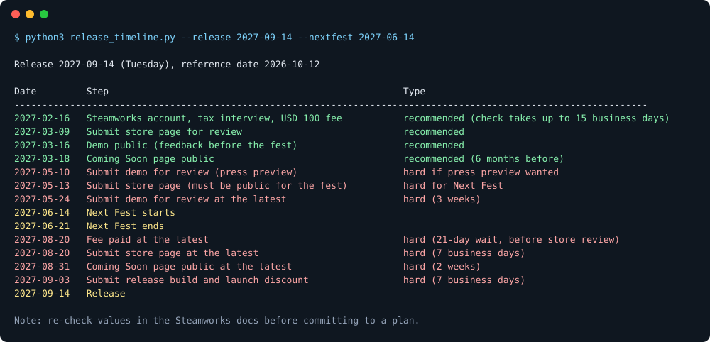

# steam-release

A Claude Code skill for indie developers who want to bring a PC game to Steam. It knows the Steamworks deadlines, store page requirements, wishlist mechanics, demo and Next Fest rules, discount blocks and AI disclosure. It plans your release backwards from a launch date.

Steam rewards lead time. Without a store page and wishlists months before launch, even a good game rarely sells. This skill keeps that in view from day one.



**Red** dates are Steam rules: miss one and you lose Next Fest or have to move your release. **Green** dates are recommended, so enough people wishlist the game before launch.

## What it covers

| Phase | Examples |
|---|---|
| Account | Steam Direct fee, 21-day wait, tax interview |
| Store page | Capsule sizes, screenshots, trailer, short description, tags |
| Wishlists | Targets, channels, festivals, streamers, press |
| Demo and Next Fest | Separate App ID, review deadlines, best timing |
| Tech | Godot export, GodotSteam, SteamPipe upload, Steam Deck |
| Launch and after | Date, price, launch discount, 30-day discount block, seasonal sales |

Official Valve rules are kept apart from community rules of thumb, and every rule links to its Steamworks source with an "as of" date.

## Tools

Two scripts, Python standard library only (Windows, macOS, Linux):

```bash
# Must-do and best-to-do dates, worked out backwards from a launch date
python3 skills/steam-release/scripts/release_timeline.py --release 2027-09-14 --nextfest 2027-06-14

# Check store and library art for size and completeness
python3 skills/steam-release/scripts/asset_check.py marketing/steam
```

`asset_check.py` expects file names like `header.png`, `small.png`, `main.png`, `vertical.png`, `library_capsule.png`, `library_hero.png`, `library_logo.png` and `screenshot_01.png`. Run it with `--help` for the full list.

## Install

As a Claude Code plugin:

```
/plugin marketplace add Vinyxsoftware/steam-release-skill
/plugin install steam-release@vinyxsoftware
```

Or copy `skills/steam-release/` into `~/.claude/skills/` (all projects) or `.claude/skills/` (one project).

The skill loads by itself when you talk about Steam, wishlists, Next Fest, capsules or a launch date. Put your project's own release context (milestones, press kit, naming rules) in the project's `CLAUDE.md`. The skill reads it first.

### Other agents

The skill uses the open `SKILL.md` format, so it also works with other coding agents that read skills, such as Codex CLI, Gemini CLI, Cursor or GitHub Copilot. Copy the `skills/steam-release/` folder to wherever your agent loads skills from.

## Works well with

- [GodotPrompter](https://github.com/jame581/GodotPrompter): Godot 4 skills for building the game itself. This skill takes over when it's time to ship on Steam.

## Keeping it current

Steam changes rules, art sizes and benchmarks from time to time. The skill tells Claude to re-check the linked Steamworks page before committing to a deadline. If you spot an outdated value, please open an issue or a pull request with the source link.

## Not legal or tax advice

The skill points tax, company and trademark questions to professionals. Wishlist and sales numbers are community estimates, not guarantees.

## Sources

- Steamworks documentation: https://partner.steamgames.com/doc
- Chris Zukowski, How To Market A Game: https://howtomarketagame.com
- GameDiscoverCo: https://newsletter.gamediscover.co
- GodotSteam: https://godotsteam.com

## License

MIT, see [LICENSE](LICENSE). Not affiliated with or endorsed by Valve. Steam and Steamworks are trademarks of Valve Corporation.
